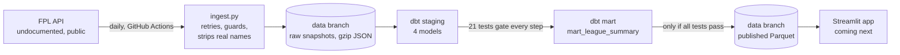
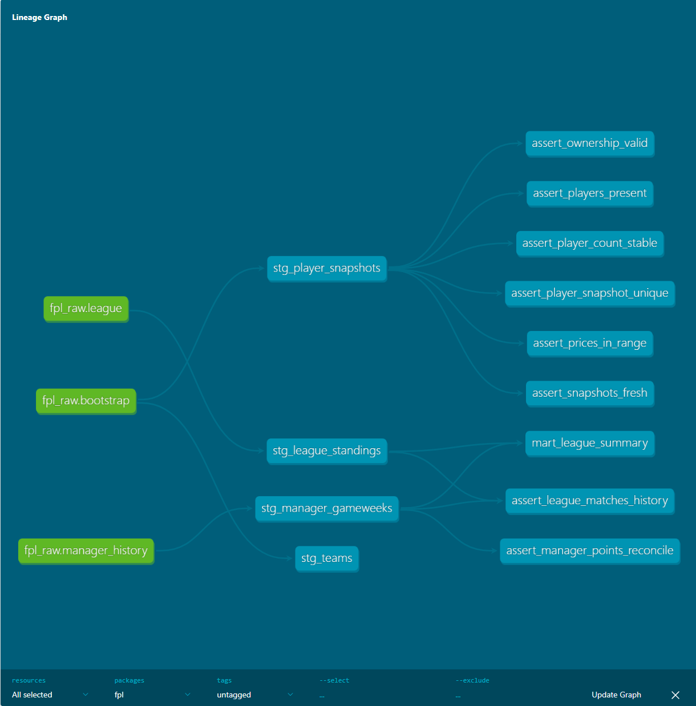

# FPL Mini-League Analytics


An automated, tested data pipeline that snapshots the Fantasy Premier League API every day and turns it into decision analytics for a 15-person mini-league: who loses the most points on the bench, who takes the most transfer hits, and how far each manager is from first place. Runs entirely on free infrastructure.

## Why I built this

I love fantasy premier league me and my friends have been playing every season since 2015-2016. we've been using 3rd party apps for the longest time and I got the idea of why not trying to build my own project that we can use. I've wanted to learn how to connect to API's, setup my own psuedo server, and create multiple pipelines / flows and connect them all together to create both a benefiecal app and a fun one at the same time.

## How it works



1. **Ingest:** every day a GitHub Actions workflow calls the FPL API, retries brief failures, refuses obviously broken responses, removes managers' real names, and saves gzip-compressed JSON to a separate `data` branch.
2. **Transform and test:** `dbt build` cleans the raw JSON into staging tables and a mart, running 21 data tests along the way. A failing test stops everything downstream of it.
3. **Publish:** only when every test passes, the mart is exported as Parquet for the app. Raw data is always kept, so a bad day can be investigated and replayed.



## Data quality

| Test | Protects against |
| --- | --- |
| `assert_manager_points_reconcile` | A manager's season total not matching the sum of their gameweeks minus transfer hits |
| `assert_league_matches_history` | The league table disagreeing with managers' own histories |
| `assert_players_present` | An empty or broken snapshot saved as a normal day |
| `assert_player_count_stable` | More than 5% of players appearing or disappearing overnight |
| `assert_snapshots_fresh` | Data silently ceasing to arrive |
| `assert_prices_in_range`, `assert_ownership_valid` | Unit and type errors (prices in tenths, numbers stored as text) |
| Built-in `unique`, `not_null`, `accepted_values`, `relationships` | Duplicates, blanks, unknown codes, broken links between tables |
| Model contract on `mart_league_summary` | The app's input changing column names or types |

## Design decisions

1. Raw data lives on a separate branch
GitHub wipes the runner after every run, so the daily files needed a permanent home that cost nothing. Committing them to `main` would have buried my own commits under a daily bot commit, and cloud storage meant setting up an account and credentials for a few megabytes. So they live on an orphan branch called `data` that shares no history with `main`: it's free, needs no secrets, and any past day can be recovered from Git history.

2. Every file is gzip-compressed
Each day's player file is about 2 MB and I keep all of them, which would add up to roughly 370 MB by May. Gzip makes each file about 11 times smaller, around 35 MB for the whole season, because JSON repeats the same field names hundreds of times. The file inside is still exactly what the API sent, and DuckDB reads gzip directly.

3. Real names are removed before anything is saved
The league endpoint returns managers' real full names, and I noticed my public repo was saving them every day without anyone's consent. I changed the ingest script to drop them before writing to disk, then force-pushed the data branch to remove the snapshot that already had them. Even then, GitHub can keep a force-pushed commit reachable by its link for a while, which taught me the real lesson: removing personal data afterwards is never complete, so don't store it in the first place. The analysis only needs manager IDs and team names anyway.

4. Raw data is always kept; only tested data is published
Each day's prices only exist on that day, so I never want to lose real data, but I also never want my friends to see wrong numbers. The pipeline retries temporary errors, refuses responses that clearly aren't data (fewer than 500 players), and saves whatever succeeded even if part of the run fails. Raw files are committed even on a failed run, but the file the app reads only updates after every dbt test passes. On a bad day, the run goes red, I get an email, and the app keeps showing yesterday's correct numbers.

5. dbt Core 1.12 instead of dbt v2
dbt v2 came out in September 2026, but its own docs warn it may not handle models that read local JSON files with `read_json()`, which is exactly what mine do, and its DuckDB support is still catching up. For a job that runs unattended every day, I chose the stable version: dbt Core 1.12 works with DuckDB, my JSON sources and Python 3.14.

## What's next
- A Streamlit app for the league, reading the published Parquet file
- A test that fails if a real name ever appears in a raw league file
- A quarantine folder for raw files that fail tests, so one bad day doesn't keep the pipeline red until I step in
- A "last updated" date in the app
- Incremental dbt models once the season's data gets large
- Moving to dbt v2 once it fully supports local file sources

## Run it locally

```powershell
git clone https://github.com/Hesh18/Fpl-Mini-League-Analysis.git
cd Fpl-Mini-League-Analysis
python -m venv .venv
.venv\Scripts\Activate.ps1
pip install -r requirements-dev.txt
git clone --branch data --single-branch https://github.com/Hesh18/Fpl-Mini-League-Analysis.git data\snapshots
cd dbt
dbt build
```

## Stack

Python 3.14 · requests · DuckDB · dbt Core 1.12 with dbt-duckdb · GitHub Actions · Parquet